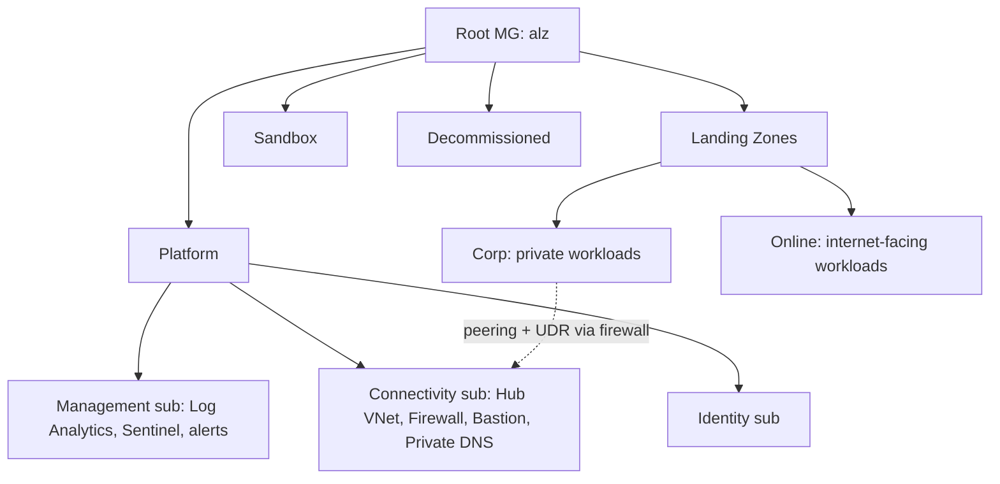

# Azure Landing Zone (Terraform)

Production-style Azure landing zone following the Cloud Adoption Framework (CAF) enterprise-scale
design: management-group hierarchy, subscription placement, **Azure Policy as code**, hub networking,
central logging/Sentinel, Defender for Cloud and RBAC, deployable through GitHub Actions with OIDC.

> Status: written for `azurerm ~> 4.10`, Terraform `>= 1.9`. Run `terraform validate` and a plan in a
> non-production tenant first (see [docs/DEPLOYMENT.md](docs/DEPLOYMENT.md)).

## What gets deployed



| Area | Implementation |
|---|---|
| Management groups | Root → Platform (Management, Connectivity, Identity), Landing Zones (Corp, Online), Sandbox, Decommissioned |
| Policy | 3 custom definitions + 1 custom initiative, 18 built-in assignments, tag governance per required tag |
| Logging | Central Log Analytics (365d), Sentinel, Activity Log to workspace via policy, alerts on high-risk operations |
| Network | Hub VNet, Azure Firewall + policy (threat intel Deny), Bastion, Private Link DNS zones, optional DDoS |
| Spoke (optional) | Peered VNet, NSG default deny, 0.0.0.0/0 to firewall, no default outbound access |
| Defender | Plans on platform subscriptions (Terraform) and landing-zone subscriptions (policy) |
| RBAC | Role assignments at MG scope through `rbac_assignments` |
| CI/CD | fmt, validate, tflint, Checkov, plan artifact, gated apply, OIDC auth |

## Repository layout

```
.
├── main.tf / variables.tf / outputs.tf / providers.tf / versions.tf / backend.tf
├── terraform.tfvars.example
├── modules/
│   ├── management_groups/   # hierarchy + subscription association
│   ├── policy/              # custom definitions (JSON), initiative, assignments, identities
│   │   └── definitions/*.json
│   ├── logging/             # Log Analytics, Sentinel, action group, activity-log alerts
│   ├── hub_network/         # VNet, Firewall, Bastion, Private DNS
│   ├── spoke_network/       # example landing-zone spoke
│   └── defender/            # Defender for Cloud plans + contact
├── scripts/                 # bootstrap-backend.sh, validate-policy-ids.sh
├── docs/                    # ARCHITECTURE, POLICIES, SECURITY-BEST-PRACTICES, DEPLOYMENT
└── .github/workflows/terraform.yml
```

## Quick start

```bash
# 1. Remote state
SUB=<mgmt-sub-id> SA=<unique-name> ./scripts/bootstrap-backend.sh
cp backend.hcl.example backend.hcl            # fill in values printed by the script

# 2. Variables
cp terraform.tfvars.example terraform.tfvars  # fill in tenant + 3 subscription IDs

# 3. Verify built-in policy IDs exist in your cloud
az login && ./scripts/validate-policy-ids.sh

# 4. Deploy (audit-only first: set policy_enforcement = false)
terraform init -backend-config=backend.hcl
terraform plan -out tfplan
terraform apply -parallelism=3 tfplan
```

Requirements: Owner/User Access Administrator at the tenant root management group for the deploying
identity, three existing subscriptions (management, connectivity, identity), `az` CLI 2.60+.

## Key inputs

| Variable | Default | Purpose |
|---|---|---|
| `tenant_id`, `*_subscription_id` | required | Tenant and platform subscriptions (must be distinct) |
| `corp_subscription_id` | `null` | Optional workload subscription for Corp |
| `prefix` / `root_display_name` | `alz` / `Contoso` | MG IDs and names |
| `location` / `allowed_locations` | `westeurope` / West+North Europe+global | Region and data-residency guardrail |
| `required_tags` / `tags` | CostCenter, Environment, Owner | Enforced + inherited tags |
| `policy_enforcement` | `true` | `false` = audit-only rollout |
| `firewall_sku` | `Standard` | `Premium` adds IDPS |
| `enable_ddos_protection` | `false` | Expensive, enable for internet-facing hubs |
| `deploy_sample_spoke` | `false` | Demo spoke in Corp |

## Documentation

- [Architecture](docs/ARCHITECTURE.md)
- [Policy catalog](docs/POLICIES.md)
- [Security and governance best practices (implemented vs manual)](docs/SECURITY-BEST-PRACTICES.md)
- [Deployment and operations runbook](docs/DEPLOYMENT.md)

## Cost notes

Azure Firewall Standard, Bastion Standard, Sentinel ingestion and Defender plans are the main costs.
Disable Bastion (`enable_bastion = false`) or Defender plans in non-production tenants.

## Contributing

Open a PR; CI runs fmt, validate, tflint and Checkov. Policy changes must update `docs/POLICIES.md`.
